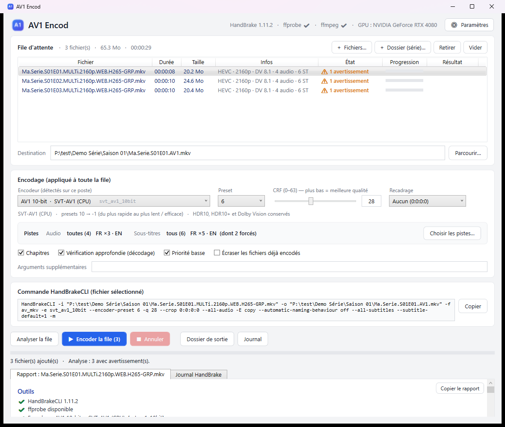
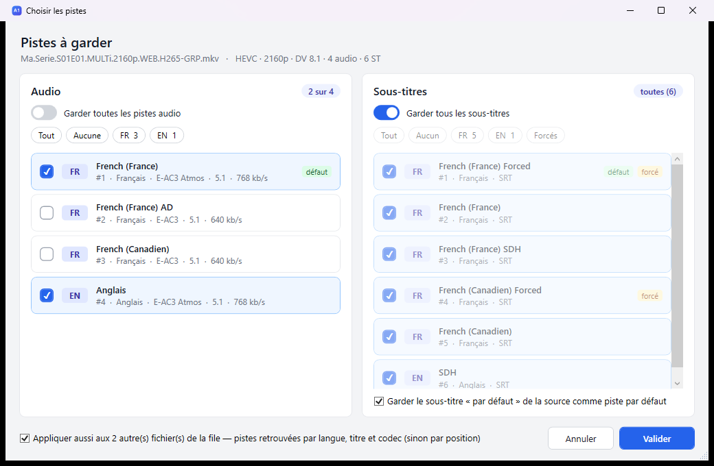
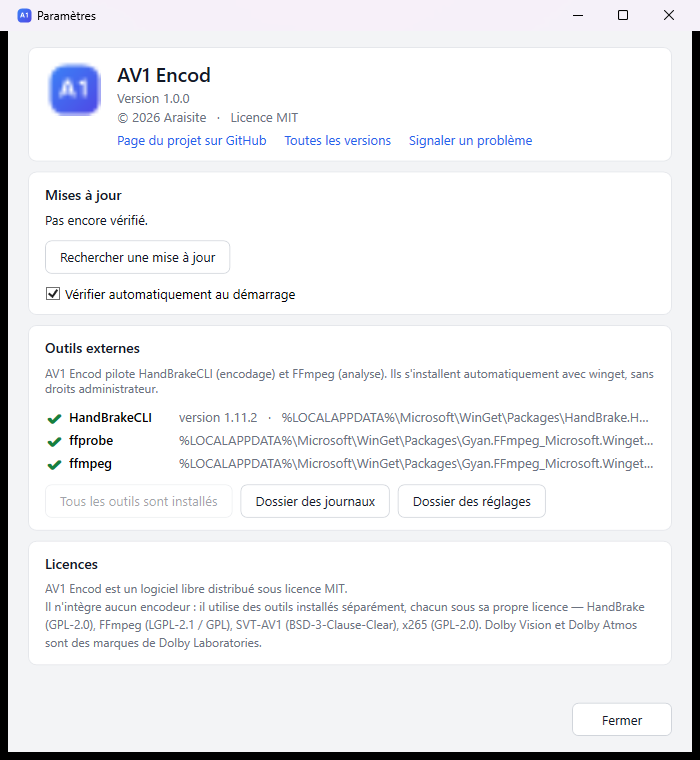

<p align="center">
  
</p>

<h1 align="center">AV1 Encod</h1>

<p align="center">
  Réencodez vos films et vos séries en <b>AV1</b> en quelques clics, sans perdre le HDR, le Dolby Vision, les pistes audio ni les sous-titres.<br>
  <a href="https://github.com/Araisite/AV1Encod/releases/latest/download/AV1Encod.exe"><b>⬇ Télécharger AV1Encod.exe</b></a>
  · Windows 10 / 11 (64 bits) · gratuit
</p>

<p align="center"></p>

---

## Sommaire

- [Ce que fait l'application](#ce-que-fait-lapplication)
- [Installation](#installation)
- [Utilisation](#utilisation)
- [Mises à jour](#mises-à-jour)
- [Questions fréquentes](#questions-fréquentes)
- [Pour les développeurs](#pour-les-développeurs)
- [Licence](#licence)

## Ce que fait l'application

AV1 Encod est une interface pour [HandBrake](https://handbrake.fr) (en ligne de commande). Elle remplace une commande du genre :

```
HandBrakeCLI -i "film.mkv" -o "film.AV1.mkv" -f av_mkv -e svt_av1_10bit --encoder-preset 6 -q 28 --crop 0:0:0:0 --all-audio -E copy --all-subtitles
```

…par un glisser-déposer, et **vérifie le fichier avant et après l'encodage**.

- **Films et séries** : glissez un fichier, plusieurs fichiers ou le dossier d'une série (les sous-dossiers « Saison 01 », « Saison 02 »… sont parcourus, les *samples* ignorés). Les épisodes sont encodés les uns après les autres.
- **Analyse de la source** avant de lancer : fichier lisible et non verrouillé (téléchargement terminé ?), durée, débit, HDR10 / HDR10+ / Dolby Vision, pistes audio et sous-titres, intégrité (décodage de 5 extraits répartis dans le film), espace disque…
- **Choix de l'encodeur** parmi ceux réellement disponibles sur le PC : SVT-AV1 (processeur), NVENC (carte NVIDIA), QuickSync (Intel), AMF (AMD), x265, x264…
- **Choix des pistes** : garder toutes les pistes audio / sous-titres, ou seulement certaines (par langue en un clic), et appliquer le même choix à toute la saison.
- **Conservation** du HDR, du Dolby Vision (profil 8.1 → AV1 10.1) et du HDR10+ avec SVT-AV1 10 bits ; audio copié sans perte ; chapitres ; sous-titre « forcé » gardé par défaut.
- **Vérification du résultat** : codec, durée identique, HDR / Dolby Vision présents, nombre de pistes, gain de place.
- **Reprise** : un épisode déjà encodé est ignoré, on peut arrêter et reprendre une saison plus tard.
- Nom de sortie court automatique, à côté de la source : `Mon.Film.2026.MULTi.2160p.HDR.DV.WEB-DL.H265-GROUPE.mkv` → `Mon.Film.2026.AV1.mkv`, `Ma.Serie.S01E03.MULTi.1080p.WEB.H264-GROUPE.mkv` → `Ma.Serie.S01E03.AV1.mkv`.

## Installation

1. **Téléchargez [`AV1Encod.exe`](https://github.com/Araisite/AV1Encod/releases/latest/download/AV1Encod.exe)** (page des versions : [Releases](https://github.com/Araisite/AV1Encod/releases)).
   C'est un fichier unique : rien à décompresser, pas besoin d'installer .NET. Rangez-le où vous voulez, par exemple dans `Documents\AV1 Encod\`, et créez un raccourci sur le bureau (clic droit → *Envoyer vers* → *Bureau*).

2. **Premier lancement : avertissement de Windows.** L'application n'est pas signée (un certificat coûte plusieurs centaines d'euros par an), Windows affiche donc :

   > *Windows a protégé votre ordinateur*

   Cliquez sur **Informations complémentaires** puis **Exécuter quand même**. Cet avertissement n'apparaît qu'une fois.

3. **Installation des outils.** Au premier lancement, AV1 Encod propose d'installer automatiquement les deux outils gratuits dont il a besoin :
   - **HandBrake CLI** — l'encodage ;
   - **FFmpeg** — l'analyse des fichiers.

   Répondez **Oui** : l'installation passe par *winget* (intégré à Windows 10/11), ne demande pas de droits administrateur et prend 1 à 3 minutes.

   <details>
   <summary>Installer les outils à la main (si winget n'est pas disponible)</summary>

   Dans un terminal :

   ```
   winget install HandBrake.HandBrake.CLI
   winget install Gyan.FFmpeg
   ```

   Ou téléchargez [HandBrake CLI](https://handbrake.fr/downloads2.php) et [FFmpeg](https://www.gyan.dev/ffmpeg/builds/), puis placez `HandBrakeCLI.exe`, `ffprobe.exe` et `ffmpeg.exe` dans le même dossier que `AV1Encod.exe` (ou dans un sous-dossier `tools`).
   </details>

C'est tout. **Désinstaller** = supprimer `AV1Encod.exe` et le dossier `%APPDATA%\AV1Encod` (réglages et journaux).

## Utilisation

1. **Ajoutez des vidéos** : glissez-les sur la fenêtre (ou boutons *+ Fichiers…* / *+ Dossier (série)…*). Chaque fichier est analysé tout de suite ; cliquez sur une ligne pour voir son rapport détaillé en bas.
2. **Réglez l'encodage** (appliqué à toute la file) :
   - **Encodeur** : `AV1 10-bit · SVT-AV1 (CPU)` par défaut, le meilleur rapport qualité / taille, qui garde le Dolby Vision. Les encodeurs de carte graphique (NVENC…) sont bien plus rapides mais un peu moins efficaces, et **perdent le Dolby Vision** (le HDR10 reste).
   - **Preset** : plus le nombre est petit, plus c'est lent et efficace. `6` est un bon compromis.
   - **Qualité (CRF)** : plus c'est bas, meilleure est l'image et plus le fichier est gros. `28` convient bien à la 4K, essayez `24`–`26` en 1080p.
3. **Pistes** : bouton **Choisir les pistes…** (ou double-clic sur un fichier de la file) pour ne garder que certaines langues ; cochez *Appliquer aussi aux autres fichiers* pour toute la saison.

   

4. **▶ Lancer l'encodage.** Une confirmation résume ce qui va être fait. Pendant l'encodage : progression par fichier et globale (aussi dans la barre des tâches), le PC ne se met pas en veille. *Annuler* propose d'arrêter tout de suite ou après le fichier en cours.

Le fichier encodé est créé **à côté de la source** ; le champ *Destination* permet de le changer pour le fichier sélectionné.

## Mises à jour

Au démarrage, AV1 Encod vérifie s'il existe une nouvelle version et affiche un bandeau **Mettre à jour** : l'application télécharge la nouvelle version, se remplace et redémarre toute seule. On peut aussi vérifier à la main dans **⚙ Paramètres → Mises à jour** (et y désactiver la vérification automatique).



## Questions fréquentes

**L'encodage est lent.** C'est normal avec SVT-AV1 en 4K (souvent 10 à 30 images/s selon le processeur, soit plusieurs heures pour un film). Pour aller plus vite : preset plus élevé (`8`, `10`) ou encodeur NVENC si vous avez une carte NVIDIA récente (RTX 40xx et plus) — au prix du Dolby Vision.

**« Déjà encodé » sur un fichier.** Le fichier de sortie existe déjà. Supprimez-le, ou cochez *Écraser les fichiers déjà encodés*.

**Avertissement « durée très courte » ou « débit très faible ».** Le fichier est peut-être un *sample* ou un téléchargement incomplet : vérifiez avant d'encoder.

**Mon antivirus bloque l'exe.** Faux positif fréquent sur les applications non signées. L'exe est construit automatiquement par GitHub à partir du code de ce dépôt (voir l'onglet *Actions*).

**Où sont les journaux ?** `%APPDATA%\AV1Encod\logs` (un fichier par encodage), accessibles aussi depuis le bouton *Journal* ou *⚙ Paramètres*.

**Un problème, une idée ?** [Ouvrez une *issue*](https://github.com/Araisite/AV1Encod/issues) en joignant le rapport (bouton *Copier le rapport*) et le journal.

## Pour les développeurs

Prérequis : [.NET 10 SDK](https://dotnet.microsoft.com/download), Windows.

```powershell
dotnet run                    # lancer en développement
.\build.ps1                   # exe autonome dans .\dist\AV1Encod.exe
```

Organisation du code :

| Fichier | Rôle |
|---|---|
| `MainWindow.xaml(.cs)` | fenêtre principale : file d'attente, réglages, encodage |
| `TrackPickerWindow.xaml(.cs)` | fenêtre de choix des pistes |
| `SettingsWindow.xaml(.cs)` | paramètres : mises à jour, outils, à propos |
| `Services/SourceAnalyzer.cs` | analyse de la source (ffprobe / ffmpeg) |
| `Services/HandBrake.cs` | détection des encodeurs et presets de HandBrakeCLI |
| `Services/EncodeOptions.cs` | construction de la ligne de commande HandBrakeCLI |
| `Services/OutputVerifier.cs` | vérification du fichier produit |
| `Services/Updater.cs` | mises à jour via les Releases GitHub |
| `Services/ToolInstaller.cs` | installation de HandBrakeCLI / FFmpeg avec winget |

**Publier une nouvelle version** : poussez un tag, GitHub Actions construit l'exe et crée la Release ; les applications installées la proposent ensuite d'elles-mêmes.

```powershell
git tag v1.1.0
git push origin v1.1.0
```

## Licence

AV1 Encod est distribué sous [licence MIT](LICENSE).

Il n'intègre aucun encodeur : il pilote des outils installés séparément, chacun sous sa propre licence — [HandBrake](https://handbrake.fr) (GPL-2.0), [FFmpeg](https://ffmpeg.org) (LGPL-2.1 / GPL), SVT-AV1 (BSD-3-Clause-Clear), x265 (GPL-2.0). Dolby Vision et Dolby Atmos sont des marques de Dolby Laboratories.
